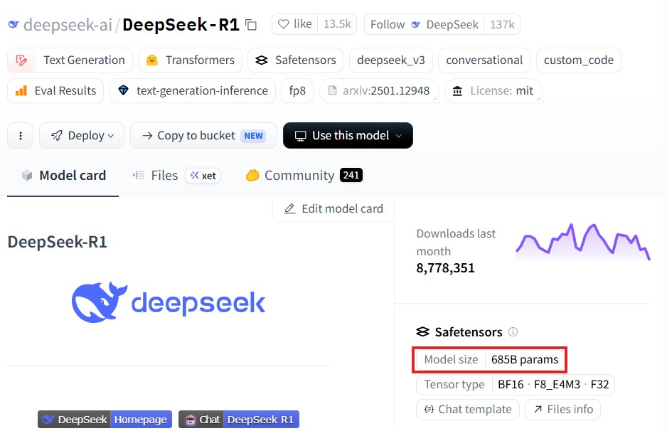
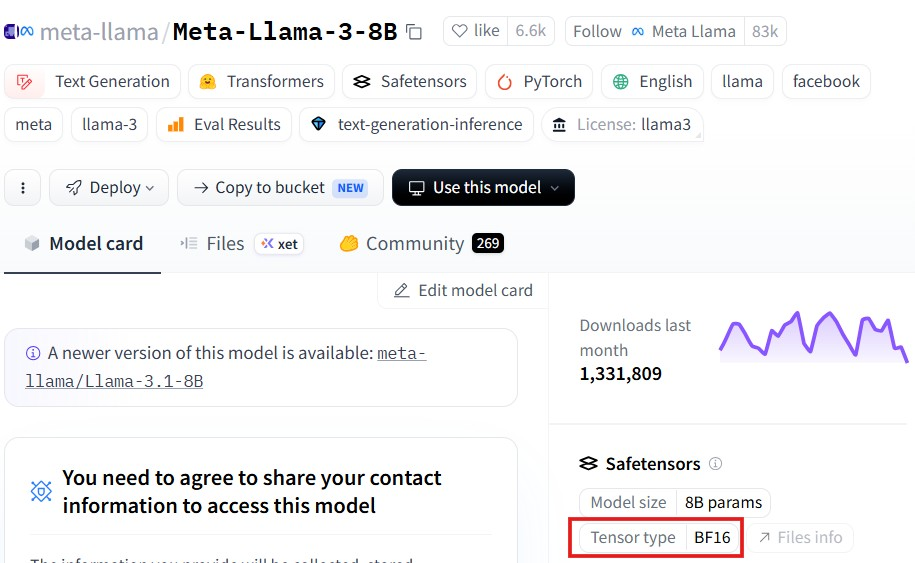

# LLM Model Size Conventions

There are a lot of AI models available in the market both open-source and closed-source. There are many ways to download and run open-source models, but the most popular is through Hugging Face. Hugging Face is a platform for sharing and downloading AI models, and it hosts a ton of them ranging from tiny models that run on your machine to massive models that require a huge server. With so many options, how do you know which model will actually run on your machine?

## Model Names and What They Tell Us

As of today there are over 2.8 million models available on Hugging Face. A few of them are:

* deepseek-ai/DeepSeek-R1
* meta-llama/Meta-Llama-3-8B
* openai/gpt-oss-120b
* mistralai/Mistral-7B-v0.1

Notice how some names include a number like **8B** or **7B**, while others don't. What do those numbers mean?

Those numbers represent the **number of parameters** (or weights) of the model. When the model is trained on huge amounts of data, these parameters are learned. Each parameter is a floating point number.

For example, **8B** means the model has 8 billion parameters, **120b** means the model has 120 billion parameters.

> **Note:** Here, both `b` and `B` mean the same. Mostly you'll find `B` but keep in mind that sometimes `b` can be used as it's used in `120b`.

But what about DeepSeek-R1? Some models don't include the size in the name - you'll need to check the model card.

## Finding Model Size from the Model Card

A model card is a file with information about the model's architecture, number of parameters etc. In Hugging Face, every model comes with a model card. For example, the `deepseek-ai/DeepSeek-R1`'s model card is available at [model card](https://huggingface.co/deepseek-ai/DeepSeek-R1). There we can find the model size is **685B parameters**.

## From Parameters to Memory: The Math

Now that we understand how to find the model size from the model name or the model card, let's get back to our original question on whether the model fits on our machine - or simply put, how do we go from "8 billion parameters" to "X GB of RAM"?

### Numeric Precision

Each parameter is a number represented in a specific numeric format. Below are a few example formats:

| number representation | description | bits per number |
| -- | -- | -- |
| fp8 | floating point number with 8-bit precision | 8 bits |
| fp16 | floating point number with 16-bit precision | 16 bits |
| bf16 | brain floating point number with 16-bit precision | 16 bits |
| fp32 | floating point number with 32-bit precision | 32 bits |
| int8 | integer number with 8-bit precision | 8 bits |

But how do we find the number representation of a model? You should know it by now, the model card!

### The Calculation

Now let's understand the math to convert parameters to GB. Let's take `meta-llama/Meta-Llama-3-8B` for this example.

We saw this model uses `bf16`. It needs 16 bits to represent one parameter. 8 bits represent a byte. So, it's 2 bytes per parameter. We have 8 billion parameters. So, $8\ \text{Billion} \times 2\ \text{Bytes} = 16\ \text{Billion Bytes} \approx 16\ \text{GB}$.

> The same math applies for smaller models. If the parameters are in millions, the result is in MB. If in thousands, it's in KB.

> **Technically**, 16 billion bytes ≈ 14.9 GiB, since RAM is measured in binary units. But in practice, people say ~16 GB.

## RAM vs VRAM vs SSD: Where Does the Model Live?

When we download a model, like any other file we download from the internet, it lives in our **SSD/HDD storage**. When we run the model, it should be loaded into the **RAM** (system memory). So, we must ensure our RAM size is significantly larger (`>>`) than the model size. But CPUs process instructions sequentially, while AI models need massive parallel computation. That's where GPUs come in. In the GPU world, the model is loaded into **VRAM** (Video RAM). So, we must ensure VRAM is significantly larger than the model size.

If the model doesn't fit in VRAM, some inference frameworks (like llama.cpp or Hugging Face Accelerate) can offload parts of the model to RAM or even SSD - but at a significant speed cost. Without such tools, you'll simply get an out-of-memory error.

## Mixture of Experts (MoE): Total vs Active Parameters

There is a class of models called **Mixture of Experts** where instead of one big network, it has multiple "expert" sub-networks. During inference, only some experts are activated per token - so not all parameters are used at once.

* **Total parameters** = all experts combined (what you need to store in memory)
* **Active parameters** = the experts used per token (what affects inference speed)

A model like DeepSeek-R1 has **685B total params** but only **~37B active per token**. This significantly changes the math we were dealing with in the previous section. For memory, we still need to store all 685B params (~1.3TB in bf16!), but inference speed is closer to a 37B model. That's a huge practical difference.

## Summary

In this post, we learned how to identify the total number of parameters used by a model from the model name or from the model card. Then we went on to understand each parameter is represented by a number that's stored in bits and how to do the math to convert those numbers to size in GBs. The formula is $\#\text{params} \times \text{bytes per param (based on precision)}$. We also explored how RAM and VRAM constraints determine whether a model can run on your hardware, and how MoE models change the picture with active vs total parameters.

If you don't have the time to do the math, you can use Hugging Face's [model memory estimator](https://huggingface.co/docs/accelerate/en/usage_guides/model_size_estimator).
